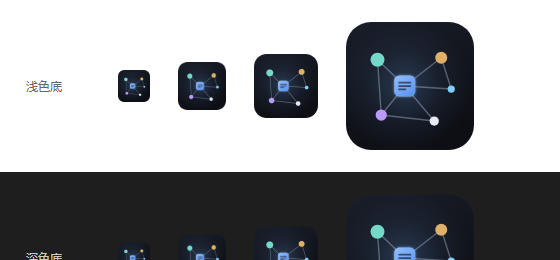

# 图标设计说明

## 一、定位

| 项 | 内容 |
| --- | --- |
| 插件名称 | **Markdowns In Graph** |
| 功能定位 | 解析 Markdown 中的 `[[双链]]` 与标准链接，生成可缩放、可筛选、可聚焦的力导向知识图谱 |
| 目标用户 | Obsidian / 双链笔记 / PKM 用户，以及用 Markdown 写作、做知识沉淀的开发者与研究者 |
| 使用场景 | VS Code 扩展市场列表、扩展详情页、活动栏与标签页小图标、README 与分享图 |

## 二、设计决策

1. **中心是一张「笔记」，不是一个普通圆点**：圆角方形 + 三行文字条，直接指向 Markdown 笔记；它同时是图谱的中心节点，表达「以笔记为中心的关系网络」。
2. **五个卫星节点 + 八条边**：包含两条非中心连线（薄荷—紫、琥珀—天蓝、紫—白），形成环路，看起来像真实力导向布局，而不是放射状的「分子结构」。
3. **深色底 + 高饱和节点**：深海军蓝底板保证在浅色与深色界面下都有对比度；节点使用插件图谱同款配色（蓝 / 薄荷 / 琥珀 / 紫 / 天蓝），与产品内部视觉一致。
4. **只在中心做光晕**：突出「当前聚焦的笔记」，其余保持扁平锐利，避免缩小后糊成一团。
5. **无文字**：16~32px 下任何字母都会糊掉，用形状与配色传达含义。
6. **圆角透明**：底板四角为透明（alpha=0），在浅色/深色背景上都不会出现白边。

## 三、尺寸与底色验证

浅色底 / 深色底下的 32、48、64、128 四档尺寸：



## 四、规格

| 文件 | 尺寸 | 用途 |
| --- | --- | --- |
| `resources/icon.svg` | 矢量 1024×1024 | 设计源文件，改色/改布局只需编辑它 |
| `resources/icon.png` | 128×128 PNG（含 alpha） | `package.json` 的 `icon` 字段，VS Code 实际使用 |
| `resources/icon-256.png` | 256×256 PNG | 高清展示 / 商店素材 |
| `resources/icon-1024.png` | 1024×1024 PNG | 主视觉、分享图、二次加工 |
| `docs/icon.png` | 256×256 PNG | 文档内展示 |

配色：

| 角色 | 色值 |
| --- | --- |
| 底板渐变 | `#191E29` → `#12151C` → `#0D0F14` |
| 中心笔记 | `#8FBEFF` → `#5A92EF`（文字条 `#0E1117` 62%） |
| 薄荷 / 琥珀 / 紫 / 天蓝 / 米白 | `#73DACA` / `#E0AF68` / `#BB9AF7` / `#7DCFFF` / `#E6EAF2` |
| 连线 | `#A9B6CF` 45%，线宽 11（1024 基准） |
| 底板描边 | `#FFFFFF` 7% |

## 五、可复用提示词（英文，适配 Midjourney / SD / DALL·E 等）

```text
Flat vector app icon for a knowledge-graph developer tool, 1024x1024, square composition with 12% padding.
Background: deep navy (#12151C) rounded-corner tile with a very subtle cornflower-blue radial glow behind the center.
Foreground: a minimal knowledge graph of five circular nodes connected by thin light blue-gray lines (#A9B6CF, 45% opacity).
The center is a larger rounded-square "note" node in cornflower blue (#6EA8FE) containing three short dark horizontal text bars,
surrounded by mint green (#73DACA), warm amber (#E0AF68), soft violet (#BB9AF7), sky blue (#7DCFFF) and off-white nodes
in an organic, asymmetric force-directed layout with three extra edges forming cycles.
Crisp sharp edges, high contrast, subtle halo only around the center node, flat design, no gradients banding,
legible at 32 pixels, modern developer-tool aesthetic.
Negative: text, letters, numbers, watermark, logo, 3D, photorealism, drop shadow, clutter, thin hairlines, more than six nodes.
```

## 六、重新导出

```bash
# 修改 resources/icon.svg 后，重新生成 1024 / 256 / 128 三种尺寸
node scripts/export-icon.js
```

`scripts/export-icon.js` 使用无头 Edge 将 SVG 画到 Canvas 上导出，保留透明通道；
如果使用其他工具（Figma、Illustrator、Inkscape），导出 1024 PNG 后按 128、256 缩放即可。
